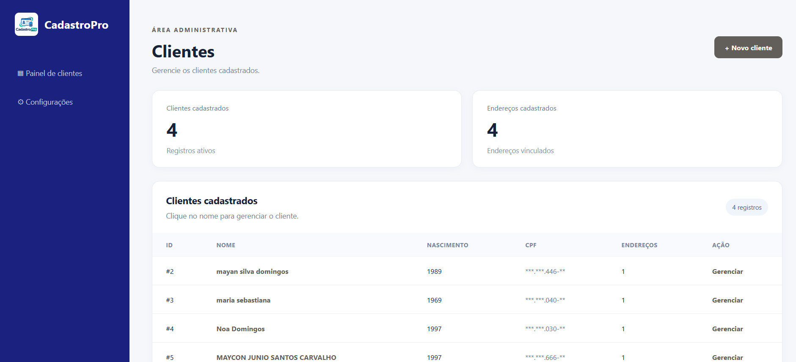
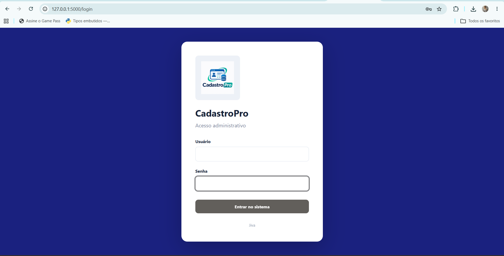
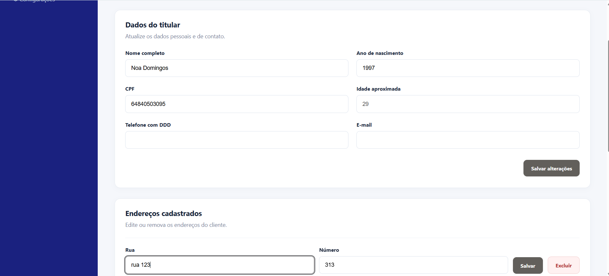

# CadastroPro 🐍

**Sistema web de cadastro e gerenciamento de clientes desenvolvido com Python, Flask, Jinja2 e SQLite3.**

O CadastroPro começou como um exercício de Programação Orientada a Objetos (POO) e evoluiu para minha primeira aplicação web. O projeto foi criado para colocar em prática conceitos estudados e entender como diferentes módulos de um sistema se conectam.

## 📸 Demonstração do sistema

### 1. Tela de login

Área de autenticação destinada ao administrador.



### 2. Painel administrativo

Visão geral dos clientes e endereços cadastrados, com acesso às funções de gerenciamento.



### 3. Gerenciamento de clientes

Tela para editar informações cadastrais e gerenciar os endereços de cada cliente.



## 🚀 Funcionalidades

- Login e logout do administrador
- Controle de acesso às páginas administrativas
- Cadastro, consulta, edição e exclusão de clientes
- Validação de CPF e verificação de CPF já cadastrado
- Registro de nome, ano de nascimento, CPF, telefone e e-mail
- Adição, edição e exclusão de endereços vinculados a clientes
- Painel com contagem de clientes e endereços
- Personalização do nome do sistema, cores, tema e logotipo
- Persistência dos cadastros e configurações em SQLite3
- Proteção CSRF nos formulários e armazenamento da senha administrativa com hash

## 🛠️ Tecnologias utilizadas

- **Python** — lógica de negócio e organização do backend
- **Flask** — aplicação web e rotas
- **Jinja2** — templates HTML dinâmicos
- **SQLite3** — banco de dados local
- **HTML e CSS** — estrutura e apresentação da interface
- **Flask-WTF** — proteção CSRF
- **Werkzeug** — geração e verificação de hash de senha
- **Pillow** — validação e tratamento da imagem de logotipo

## 📂 Estrutura do projeto

```text
cadastro_cliente/
├── docs/
│   └── imagens/
│       ├── login.png
│       ├── painel.png
│       └── gerenciamento.png
├── static/
│   ├── admin.css
│   ├── style.css
│   └── tema.css
├── templates/
│   ├── base.html
│   ├── cliente.html
│   ├── configuracoes.html
│   ├── index.html
│   └── login.html
├── app.py
├── cadastro_cliente.py
├── configuracoes.py
├── interface.py
├── main.py
├── modelos.py
├── setup_admin.py
├── validacoes.py
├── requirements.txt
├── .gitignore
└── README.md
```

> A pasta `static/uploads/`, o banco `clientes.db` e o arquivo `admin_config.json` são gerados ou usados localmente e não devem ser publicados com dados privados.

## ⚙️ Como executar localmente

### 1. Clone o repositório

```bash
git clone https://github.com/mayconcarvalho420/CadastroPro.git
cd CadastroPro
```

### 2. Crie e ative um ambiente virtual

No Windows (PowerShell):

```powershell
python -m venv venv
.\venv\Scripts\Activate.ps1
```

### 3. Instale as dependências

```powershell
python -m pip install -r requirements.txt
```

### 4. Configure o administrador

Na primeira execução, crie o usuário e a senha administrativa:

```powershell
python setup_admin.py
```

O programa solicitará um nome de usuário e uma senha com no mínimo 12 caracteres. A configuração local será armazenada em `admin_config.json`, com hash da senha e chave secreta gerada aleatoriamente.

### 5. Inicie a aplicação

```powershell
python app.py
```

Acesse **http://127.0.0.1:5000** no navegador.

O arquivo `clientes.db` e as tabelas necessárias são criados automaticamente pela aplicação ao inicializar seus componentes.

> **Importante:** este projeto está configurado para execução local e demonstração de estudos. Antes de disponibilizá-lo publicamente na internet, é necessário revisar as configurações de produção, HTTPS, cookies de sessão e segurança do ambiente.

## 🧠 Conceitos praticados

- Programação Orientada a Objetos: classes, herança e composição
- Separação das responsabilidades entre módulos
- Criação de rotas e processamento de formulários
- Renderização de templates
- Operações CRUD com SQLite3
- Validação de dados e tratamento de erros
- Autenticação e controle de acesso
- Integração entre backend e interface web

## 🎯 Sobre o aprendizado

O CadastroPro representa uma etapa da minha transição de carreira para a programação. Durante o desenvolvimento, pude acompanhar a evolução de um exercício de POO para um sistema web funcional, com apoio de ferramentas de IA na implementação, nos testes e na compreensão de novos conceitos.

O projeto continua sendo uma oportunidade de praticar, revisar decisões técnicas e aprofundar meus conhecimentos em Python e desenvolvimento backend.

## 👨‍💻 Autor

**Maycon Junio Santos Carvalho**

[GitHub — mayconcarvalho420](https://github.com/mayconcarvalho420)
